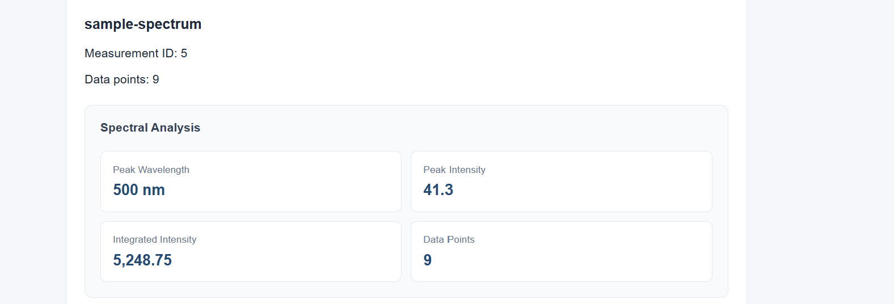

# SpectraLab — Scientific Measurement Dashboard

A full-stack scientific measurement application built with C#, ASP.NET Core, Angular, TypeScript and SQLite.

This project explores how measurement data can be imported, validated, stored, analysed and visualised through a web application.

**Note:** The included CSV files contain synthetic demonstration data, not measurements from a real scientific instrument.



## Technology Stack

- Backend: C#, .NET 10, ASP.NET Core Web API
- Frontend: Angular, TypeScript, HTML, CSS, SVG
- Database: SQLite, Entity Framework Core
- Testing: xUnit, ASP.NET Core integration tests
- CI: GitHub Actions

## Features

- Import two-column spectroscopy-style CSV files
- Validate measurement values before storage
- Store and retrieve measurement records using REST APIs
- Persist data in a SQLite relational database
- Visualise intensity against wavelength
- Calculate the highest sampled spectral peak
- Compute integrated intensity using trapezoidal integration
- Display analysis results in the Angular interface

## Architecture

Angular Frontend
    |
    | HTTP / JSON
    v
ASP.NET Core Web API
    |
    +-- EF Core --> SQLite
    |
    +-- SpectrumAnalyzer (C#)

The API separates measurement persistence from numerical analysis.

## Engineering Challenges and Decisions

### 1. Irregularly spaced measurement data

**Problem:** Scientific measurements may have unequal wavelength intervals. Assuming a fixed interval can produce incorrect numerical integration results.

**Solution:** Implemented a C# analysis service that sorts data by wavelength and calculates integrated intensity using the trapezoidal rule with actual wavelength differences.

**Verification:** xUnit tests check an irregularly spaced, unsorted example against a known analytical result.

### 2. Frontend and backend communication

**Problem:** The Angular development server and ASP.NET Core API run on different ports, causing browser requests to fail without the correct cross-origin policy.

**Solution:** Configured an explicit ASP.NET Core CORS policy for the local Angular development origin.

### 3. Database isolation in integration tests

**Problem:** Initial API integration tests unexpectedly accessed existing measurement records instead of an empty test database.

**Solution:** Reconfigured the test host to use a separate in-memory SQLite database for each integration test.

**Verification:** Tests check empty database behaviour, successful POST/GET operations, invalid requests and numerical analysis responses.

## Local Setup

### Requirements

- .NET 10 SDK
- Node.js 24
- npm

### Start the backend

From the repository root:

```bash
dotnet run --project backend/SpectraLab.Api --urls http://localhost:5071
```

The API is available at:

http://localhost:5071/api/measurements

### Start the frontend

Open another terminal:

```bash
cd frontend
npm ci
npm start
```

Open:

http://localhost:4200

The backend must also be running for data loading and analysis to work.

## Example Data

A sample dataset is provided at:

`sample-data/sample-spectrum.csv`

The synthetic spectrum contains nine wavelength-intensity points with a maximum sampled intensity of 41.3 at 500 nm.

## API Endpoints

| Method | Endpoint | Purpose |
|---|---|---|
| GET | /api/measurements | List measurements |
| GET | /api/measurements/{id} | Retrieve one measurement |
| POST | /api/measurements | Save a measurement |
| GET | /api/measurements/{id}/analysis | Calculate spectral analysis |

## Testing

Run backend tests:

```bash
dotnet test tests/SpectraLab.Tests --configuration Release
```

Build the frontend:

```bash
cd frontend
npm run build
```

GitHub Actions runs both checks on pushes and pull requests.

## Current Limitations

- Designed for local development; no hosted demo yet
- Supports a simple two-column CSV format
- Peak detection identifies the highest sampled intensity, not multiple local peaks
- The chart uses automatic scaling without numerical axis ticks
- Measurement data is simulated; no physical instrument integration
- Database initialization uses EnsureCreated rather than EF Core migrations
- Duplicate wavelengths are rejected by analysis but are not yet rejected at upload

## Future Improvements

- Align upload validation with spectral analysis requirements
- Add numerical axis ticks and measurement selection
- Introduce EF Core migrations
- Extend tests and support more advanced spectral analysis
